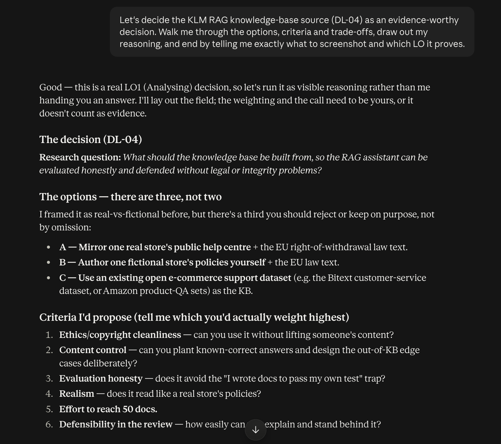
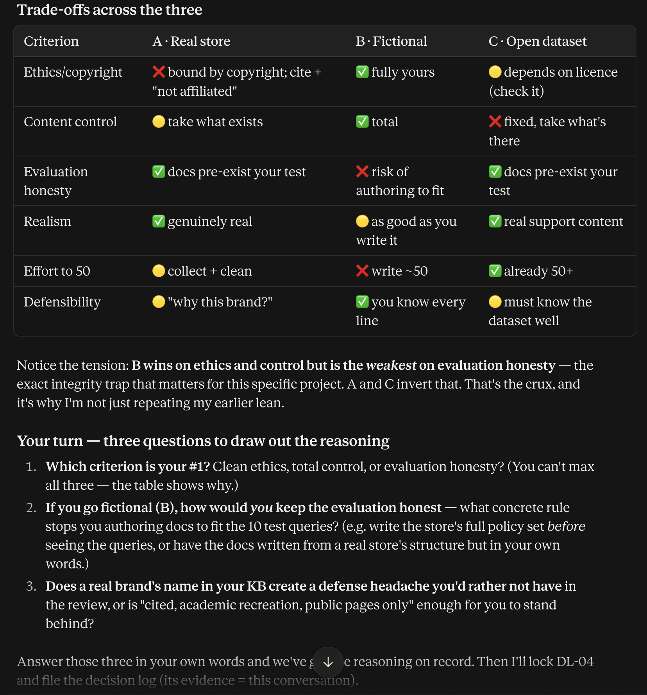

# Decision Log Entry 9 — KB source: self-authored fictional store

**Portfolio name (PortFlow):** `[DL] What should the KLM RAG knowledge base be built from? (LO1)`

*Official MA-AAI course template. Related: Decision Logs — Index · KLM RAG — Project Kickoff & Decision Log · Portfolio — Home.*

## 0. Context — why does this question exist?
- **Project / assignment this belongs to:** KLM RAG (Professional Research Project) — the "DL-04" open item from the kickoff.
- **Why this matters right now:** I can't gather or write the required 50+ document knowledge base, or write the 10 test queries, until I know where the documents come from. Everything downstream (chunking, retrieval, evaluation) sits on this.
- 🔗 **Where this fits:** follows 2026-09-19 — Domain locked to a single e-commerce store (domain = one online store) and the kickoff's DL-04. Anchors the KB before the build phase.

## 1. My research question
What should the knowledge base be built from, so the assistant can be evaluated **honestly** and defended without **legal or integrity** problems?

## 2. Current LO stage
Analyzing.

## 3. What makes a good decision here?
- **Copyright/sourcing clean** — no real company's text reused without right to.
- **Content control** — I can guarantee every document is correct, and can deliberately design the out-of-KB edge cases (target: 3+ of the 10 queries unanswerable by design).
- **Evaluation honesty** — the KB must not be reverse-engineered to pass my own test queries, or the >80% retrieval / >70% approval numbers mean nothing.
- **Effort to reach 50 docs** — achievable solo in the time I have.

## 4. What I decided
Build the KB from a **self-authored fictional single online store** (its own policy documents) plus the public **EU right-of-withdrawal** legal text — Option B. Protect evaluation honesty with **freeze-then-test**: write the full document set first, then write the 10 test queries, and never edit a document afterward to make a query pass.

## 5. Why this decision
- **Method I used:** compared three options — (A) mirror a real store's public help centre, (B) self-author a fictional store, (C) use an open e-commerce support dataset — against the criteria above, in a trade-off table.
- **What I found / observed:** A is genuinely real but copyright-bound and invites a "why this brand?" question in the defense. C is realistic and pre-exists my test (honesty-safe) but I can't control content or plant edge cases. B maximizes control and removes the copyright question entirely, but is the **weakest on evaluation honesty** — the risk of writing docs that conveniently answer my own questions. That risk is closable at near-zero cost by fixing the *order* of work (freeze-then-test).
- 🔗 **Evidence & artifacts:** this Cowork conversation, 2026-09-28 — the options table, criteria, trade-offs, and my reasoning through the honesty trap:

  **⟶ TO DO:** also paste this chat's **share link** here for PortFlow (the live conversation is the strongest evidence; the screenshots are the backup). Other refs: the KLM RAG board (KB-source card); KLM RAG — Project Kickoff & Decision Log §3.
- **What this means:** the only serious objection to B is integrity, and freeze-then-test answers it. The copyright cleanliness and full correctness control outweigh the loss of real-world realism for a research prototype.
- **So I decided:** B, with freeze-then-test as the guardrail.

## 6. Does this hold up?
*Decided just now — results pending until the KB and queries exist.*
- Copyright clean: ✅ (nothing real reused).
- Content control: ✅ (I author every line).
- Evaluation honesty: 🟡 — protected in principle by freeze-then-test; only proven once the KB is frozen and the queries are written against it (a dated file / commit will be the paper trail).
- Effort to 50: 🟡 — untested; writing ~50 docs is real work.
- **Assumptions I'm making:** that I'll actually hold the freeze discipline, and that self-authored policies are realistic enough for a valid demo.
- **What surprised me:** my first instinct was that fictional is the "safest" option; the analysis showed it's the *riskiest* on evaluation honesty — the opposite — which is why the freeze rule matters.
- **Note on ethics:** going fictional removes only the *sourcing/copyright* ethics concern. The RAG system ethics the brief requires — hallucination, wrong citations, out-of-KB refusal, outdated info, retrieval bias — remain in scope and are handled in the write-up.

## 7. What this unlocks
- 🔗 **Implementation evidence:** (pending) the frozen KB folder + a dated first version; the 10 test queries written after it.
- **Next LO stage:** still Analyzing → moving into Designing/Realizing as the KB and pipeline get built.
- **What I can now do (that I couldn't before):** start writing the store's document set — the KB source is settled.
- **How I'll know this worked:** retrieval accuracy measured on queries the KB was *not* tuned to pass (>80% target), with the freeze order evidenced by file/commit dates.
