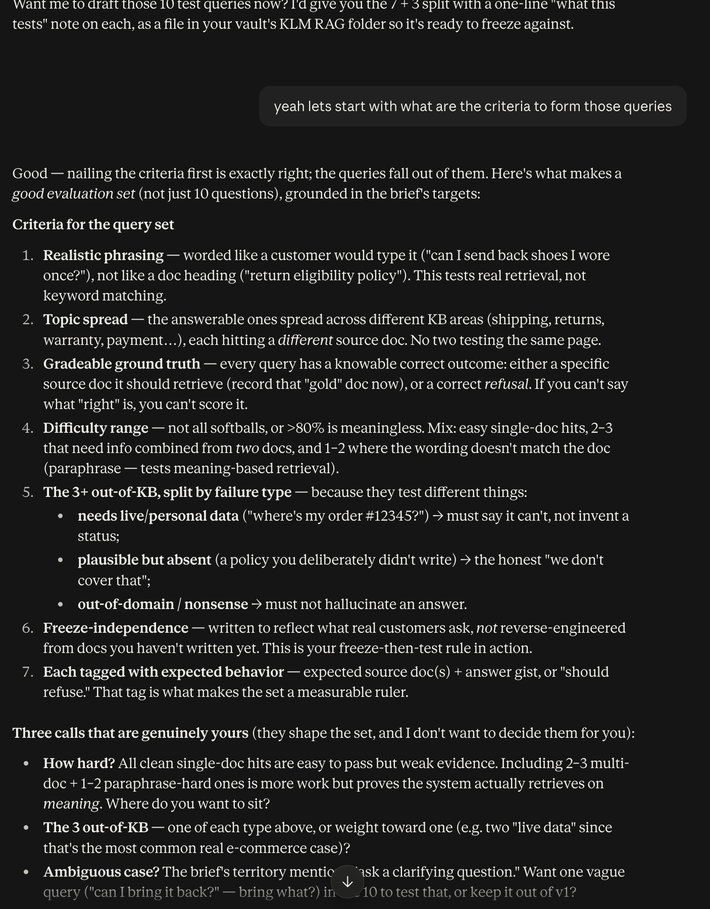

# Decision Log Entry 11 — Evaluation method: 10 hard queries + scoring rubric

**Portfolio name (PortFlow):** `[DL] How will I test the RAG assistant, and what counts as passing? (LO3)`

*Official MA-AAI course template. Related: Test Queries (v1 — frozen before KB) · 2026-09-17 — Test-first success criteria for the RAG assistant (log #6) · 2026-09-28 — KB source — self-authored fictional store (log #9) · Decision Logs — Index.*

## 0. Context — why does this question exist?
- **Project:** KLM RAG. Log #6 set the headline targets (retrieval >80%, answers >70%, citations 100%); this entry designs the actual instrument that produces those numbers.
- **Why now:** the targets are meaningless without a fixed query set and explicit scoring rules — and, under freeze-then-test (log #9), the query set must exist before any KB document.
- 🔗 Where it fits: test-first criteria (#6) → this evaluation design → KB build → run.

## 1. My research question
How do I test this RAG assistant so the results are honest and defensible — what do I ask it, and what counts as passing?

## 2. Current LO stage
Designing (designing the evaluation instrument), building on Analyzing (#6).

## 3. What makes a good decision here?
- The set exercises real retrieval, not keyword luck (realistic phrasing, meaning-based).
- It can't be gamed: written before the KB, and it stresses the known failure modes rather than only easy hits.
- Every query is objectively gradeable (a named gold doc, or a correct refusal / clarifying question).

## 4. What I decided
A **frozen 10-query set**, weighted **hard**: 6 answerable (mixing paraphrase and multi-doc), 1 ambiguous (must ask a clarifying question), and 3 out-of-KB — one each of *needs-live-data*, *plausible-but-absent*, and *out-of-domain*. Scored by: **retrieval** = gold doc(s) in **top-3** (all of them for multi-doc queries), over the 6 answerable, target >80%; **answer approval** = per-query all-or-nothing human check (correct + grounded + cited + right edge behavior), over all 10, target >70%; **citations 100%** enforced as a hard gate inside the approval check.

## 5. Why this decision
- **Method:** worked the criteria for a valid eval set as visible reasoning (realism, topic spread, gradeable ground truth, difficulty range, the three edge types, freeze-independence, expected-behavior tags), chose the distribution, then defined scoring to match.
- **What I observed:** a set of only easy single-doc hits would pass trivially and prove nothing; the value is in the hard cases (paraphrase, multi-doc, and the three refusal types) — so retrieval is scored strictly (top-3, all gold docs) and citation errors fail an answer outright.
- 🔗 **Evidence & artifacts:** this Cowork conversation, 2026-09-29 (criteria → my three design calls → the drafted set → the three scoring calls) :

  

  **⟶ TO DO: also paste this chat's share link.** Also: Test Queries (v1 — frozen before KB) (the frozen set + scoring spec).
- **What this means:** passing this set actually means the system retrieves on meaning, refuses when it should, and never cites a source that doesn't hold — which is what the brief's numbers are supposed to certify.
- **So I decided:** lock the set and the scoring as above.

## 6. Does this hold up?
*Decided just now — results pending until the KB exists and the run happens.*
- Realistic + hard: ✅ by design (paraphrase, multi-doc, 3 edge types, 1 ambiguous).
- Un-gameable: 🟡 rests on the freeze holding (queries dated before KB; enforce by not editing them).
- Gradeable: ✅ each answerable query names a gold doc; edge/ambiguous have defined correct behavior.
- **Assumptions:** that top-3 is the right retrieval window (revisit if the KB is large), and that a single human grader is consistent.
- **What surprised me:** scoring citations as a hard *fail* inside approval (rather than a separate %) is what actually makes "100% citations" bite.

## 7. What this unlocks
- 🔗 Implementation evidence: (pending) retrieval + approval scores per query once the system runs.
- **Next LO stage:** Realizing — build the ~50-doc KB (covering the gold topics, plus extra docs, and deliberately no price-match doc), then run against this set.
- **What I can now do:** build the KB against a fixed target, and measure honestly the moment it runs.
- **How I'll know it worked:** ≥5/6 retrieval, ≥7/10 approved, zero approved answers with a bad citation.
