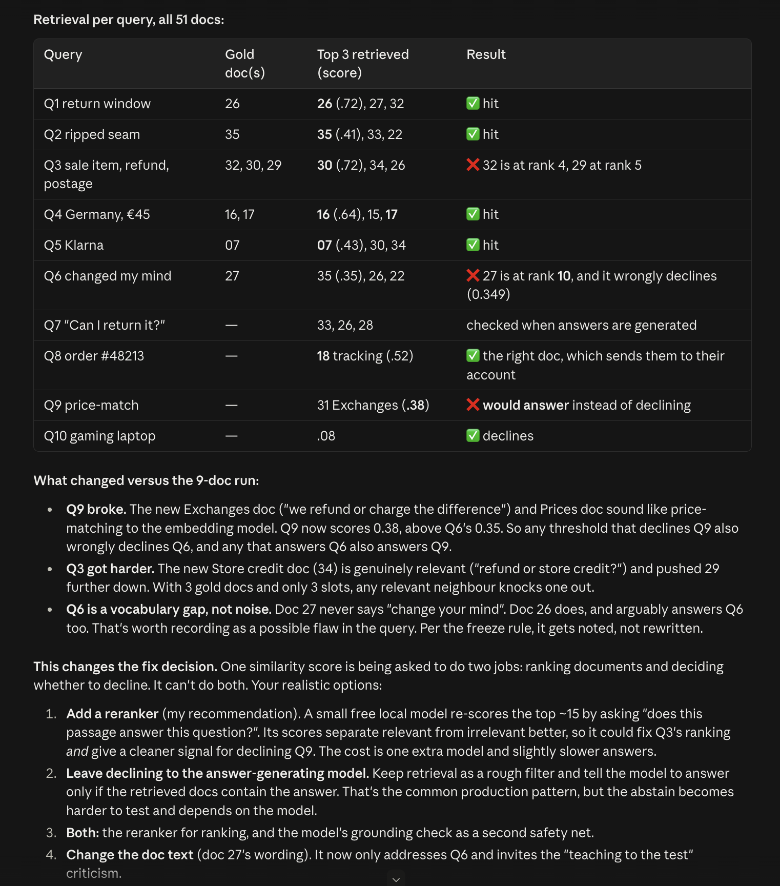

# Decision Log Entry 13 — Full KB broke the abstain threshold

**Portfolio name (PortFlow):** `[DL] The full KB broke the abstain threshold — reranker, LLM grounding, or both? (LO4)`

*Related: 2026-10-01 — Spike confirms RAG stack (retrieval fix) (#12, the claim this corrects) · 2026-09-29 — Evaluation method (10 queries + scoring) (#11) · 2026-09-28 — KB source — self-authored fictional store (#9) · Decision Logs — Index.*

> ✅ **Status: fix path decided (2026-10-01).** Two signals, two jobs — a cross-encoder reranker for *ranking*, an LLM grounding check for *abstention*, and the retrieval threshold demoted to a ~0.15 floor. Implementation + re-measured result still to come.

## 0. Context — why does this question exist?
- **Project / assignment:** KLM RAG — build step 2 ("confirm retrieval >80%; re-tune the abstain threshold") run on the full 51-doc KB in `KLM RAG — Build/`.
- **Why this matters right now:** generation (step 4) can't start on a retriever that misses gold docs and would *answer* a question it must refuse (Q9 price-match). Every later score inherits this.
- 🔗 **Where this fits:** follows #12 — the spike's 100% did not carry over to real document text (67% on the 9 real gold docs). The plan was "re-tune the threshold at full KB"; this is that re-tune, and it failed.

## 1. My research question
Can top-3 cosine retrieval with a single abstain threshold both find the right policy docs (>80%) **and** refuse out-of-KB questions on a realistic 51-doc KB — and if not, what second signal is needed?

## 2. Current LO stage
Realizing (running the real build and measuring it), with Analyzing the failure.

## 3. What makes a good decision here?
- **Retrieval >80%** over the 6 answerable frozen queries (gold doc(s) in top-3; multi-doc = all golds). Below this, the generator answers from the wrong policy.
- **Out-of-KB abstain 2/2** (Q9 price-match, Q10 gaming laptop). A wrong answer here is the worst failure for a customer-service bot — it invents policy.
- **No test gaming:** frozen queries and `top_k = 3` untouched; any KB text change must be justifiable without reference to a query.

## 4. What I decided
**Settled by the data:** stop trying to fix this with the abstain threshold — one cosine score cannot separate answerable from unanswerable queries on the full KB, so a **second relevance signal is required**.
**Fix path (decided):** option (3), both — but for a sharper reason than "two safety nets". The threshold was collapsing two different jobs into one score, so split them:
- a **cross-encoder reranker** does the *ranking* job (re-scores the top ~15 for "does this passage answer the question?", recovering Q3's displaced golds);
- an **LLM grounding check** at generation does the *abstention* job (answer only if the retrieved context states it, else refuse — this is what catches Q9);
- the **retrieval threshold drops to ~0.15**, demoted to a cheap floor that only rejects the obvious-nothing case (Q10).

The threshold is no longer asked to separate Q6 from Q9, which the sweep proved impossible.

## 5. Why this decision
- **Method I used:** built ingest → Chroma index (MiniLM, title+body) → top-3 retrieval → `run_eval.py` against the 10 frozen queries; re-indexed all 51 docs; added a `--sweep` that compares the lowest answerable top-1 score with the highest out-of-KB one; traced the gold-doc ranks for every miss.
- **What I found / observed (51 docs, threshold 0.35):**

  | Query | Gold | Top-3 (score) | Result |
  |---|---|---|---|
  | Q1 | 26 | 26 (.72), 27, 32 | ✅ |
  | Q2 | 35 | 35 (.41), 33, 22 | ✅ |
  | Q3 | 32, 30, 29 | 30 (.72), 34, 26 | ❌ 32 @4, 29 @5 |
  | Q4 | 16, 17 | 16 (.64), 15, 17 | ✅ |
  | Q5 | 07 | 07 (.43), 30, 34 | ✅ |
  | Q6 | 27 | 35 (.35), 26, 22 | ❌ 27 @10, wrongly abstains (.349) |
  | Q9 | — | 31 Exchanges (.38) | ❌ would answer |
  | Q10 | — | .08 | ✅ abstains |

  **Retrieval 4/6 = 67%; abstain 1/2.** Sweep: lowest answerable = Q6 **0.349**, highest out-of-KB = Q9 **0.379** → **not separable by any threshold.** On the 9-doc slice they *were* separable (gap 0.11) — the new docs closed it.
- **Root causes:** Q9 now matches *Exchanges* ("refund or charge the difference") and *Prices* — price vocabulary without a price-match policy. Q3 has 3 golds for 3 slots, and the new *Store credit* doc (34) is genuinely relevant, so it displaces 29. Q6 is a vocabulary gap: doc 27 never says "change your mind", doc 26 does (and arguably also answers Q6 — **noted as a possible query flaw, not rewritten**).
- **Alternatives + trade-offs:**
  1. *Cross-encoder reranker* (free, local) re-scores top ~15 for "does this passage answer the question?" — could fix Q3's ranking **and** give a better-calibrated abstain signal. Cost: one more model, more latency.
  2. *LLM grounding abstain* — retrieval is a coarse filter, the generator refuses if the context lacks the answer. Standard in production, but abstain becomes model-dependent and harder to test.
  3. *Both* — reranker for ranking, LLM check as a safety net.
  4. *Edit doc text* (doc 27 wording) — fixes only Q6 and risks "teaching to the test".
  Rejected outright: raising top-k (frozen scoring config); further threshold tuning (shown impossible).
- 🔗 **Evidence & artifacts:**
  - **AI conversation:** Claude Code session (desktop, 2026-10-01, worktree `klm-rag-build-setup-a70ad7`) — the 9-doc diagnosis (6 embedding variants; only the spike's hand summaries scored 6/6), then the 51-doc run, per-query table and options. **⟶ TO DO: export the transcript / share link and add it here.**
  - **Screenshot:** per-query table + "what changed" + the four options:

    
  - Code: `KLM RAG — Build/src/run_eval.py` (`--reindex`, `--sweep`), commit `ed5d0fe` on main.
- **What this means:** the threshold was being asked to do two jobs — rank docs and decide whether to answer. A realistic KB full of near-neighbour docs breaks that. The spike's flattering result (#12) hid it because 9 hand-summarised docs had no confusable neighbours.
- **So I decided:** retire "re-tune the threshold" as the plan and add a second relevance signal; which one is the open choice above.

## 6. Does this hold up?
- Retrieval >80%: ❌ 67% (4/6) — current state, before any fix.
- Out-of-KB abstain 2/2: ❌ 1/2 — Q9 would answer.
- No test gaming: ✅ queries and top-3 untouched. **Q6 gold label frozen as doc 27 (statutory withdrawal) — not relabelled.** The retriever surfaced doc 26 (30-day change-of-mind returns), arguably also correct; but relabelling Q6's gold to 26 would flip it to a HIT and lift retrieval to 5/6 (83%) by editing the answer key — the textbook "teaching to the test" move. Kept as a documented miss: a change-of-mind question has two valid answers (the store's 30-day policy and the 14-day statutory right), and that ambiguity *is* the finding, not a number to inflate.
- **Assumptions I'm making:** the 10 frozen queries are representative enough to choose a fix on; a reranker's scores will separate Q6 from Q9 (untested — a quick experiment was offered); KB content is final apart from the doc-22 fix below.
- **What surprised me:** adding *more, realistic* docs made out-of-KB refusal worse, not better — neighbours with overlapping vocabulary (exchanges/prices) look like a price-match answer. And the 9-doc "separable" margin looked healthy right up until the KB was complete.
- **Also found → FIXED (2026-10-01):** a KB contradiction — doc 22 (damaged in transit) said report **within 14 days**, gold doc 35 says **30 days**. Doc 22 now reads 30 days, consistent with doc 35. KB text only; queries and gold labels untouched, so no test gaming.

## 7. What this unlocks
- 🔗 **Implementation evidence:** `KLM RAG — Build/` on main (`ed5d0fe`, merge `bb53454`); eval reproducible with `.venv/bin/python src/run_eval.py --reindex` / `--sweep`.
- **Next LO stage:** Realizing — implement the chosen fix, re-run the eval, then build `generate.py` + `verify.py`.
- **What I can now do (that I couldn't before):** measure retrieval *and* abstain separability on the real KB with one command, and show exactly which doc displaced which gold — so any fix is judged on numbers, not hope.
- **How I'll know this worked:** after the fix, retrieval ≥5/6 (>80%), Q9 + Q10 both abstain, Q6 no longer falsely abstains — on the unchanged frozen queries.
